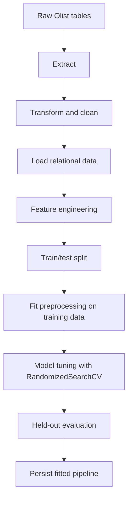
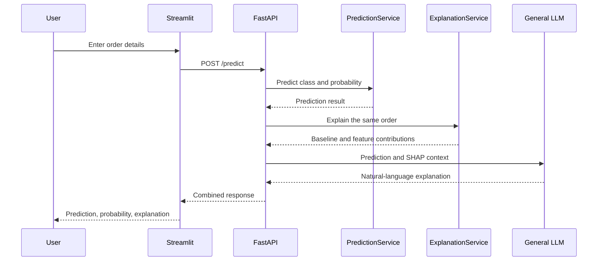
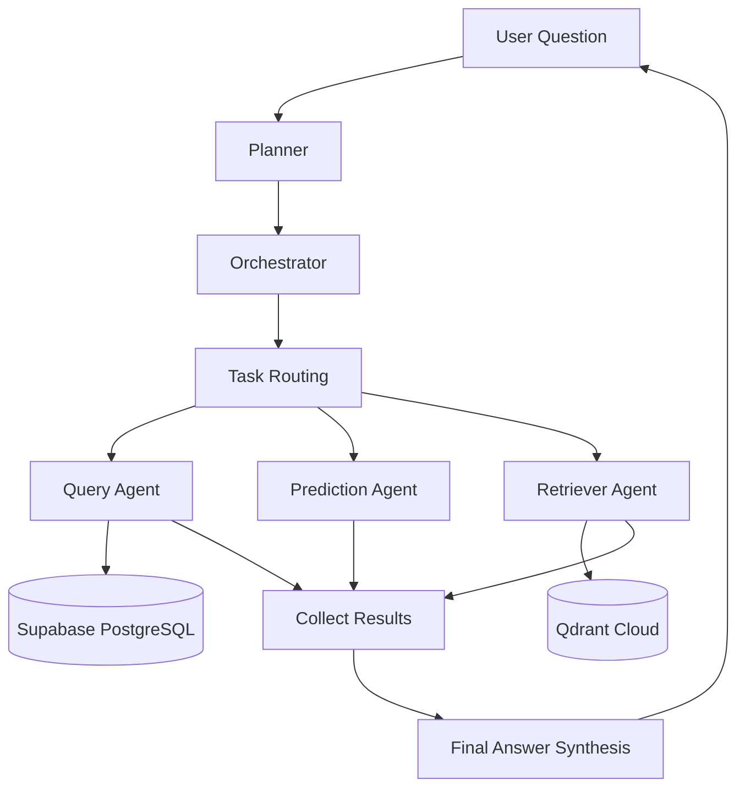

# System Architecture

## Purpose

The application combines a supervised delivery-delay classifier with an API, a Streamlit UI, SHAP explanations, and an agentic-AI workflow for supported database and retrieval tasks.

This is a logical architecture. Check the current source code and Docker Compose configuration for exact ports, service names, and runtime boundaries.

## Data and ML Workflow



The inference service loads the persisted fitted pipeline and applies the same transformations used during training. Preprocessing should be fitted on training data only to avoid data leakage.

**Implementation note:** A separate automated data-validation stage was skipped in the current implementation and is not represented as a completed component in this workflow.

## Prediction and Explainability



The LLM explains the model's output using the supplied prediction and SHAP results. It should not replace the classifier or invent causal reasons for the prediction.

## SHAP Design

The explanation service reuses the pipeline's fitted `preprocessor` and `best_model` steps. It transforms a representative background sample, initializes a probability-output `TreeExplainer`, and computes SHAP values for each submitted order.

- **Positive SHAP contribution:** Pushes late-delivery probability upward relative to the baseline.
- **Negative SHAP contribution:** Pushes late-delivery probability downward relative to the baseline.
- **Probability reconstruction:** The baseline plus all contributions should approximately reconstruct the explained probability when the explainer is configured consistently.
- **Top-ranked contributions:** Only selected contributions are returned to the UI and LLM. The baseline plus the displayed top-five values will not generally equal the final probability.
- **Transformed feature names:** One-hot encoding may cause SHAP feature names to reference transformed columns rather than original business fields.

SHAP describes model attribution, not causation. The background sample should be representative of training inputs and exclude the target column.

## Agentic-AI Workflow

The agentic-AI workflow coordinates specialized agents to answer supported user requests.

### Components

- **Planner:** Converts the user's request into a structured task plan.
- **Orchestrator:** Tracks task dependencies and routes ready tasks to appropriate workers.
- **Query Agent:** Handles supported structured-data questions using database tools.
- **Prediction Agent:** Handles tasks that require the delivery-prediction capability.
- **Retriever Agent:** Retrieves relevant contextual information from the configured vector store.
- **Result collection:** Collects worker outputs and associates them with their tasks.
- **Final-answer synthesis:** Combines completed task results into a response.
- **Streaming progress updates:** Reports workflow progress where implemented.

### Logical Agent Flow



The diagram shows the logical workflow rather than a guarantee that all agents run for every request. Actual task execution depends on the plan, dependencies, and routing logic.

The direct SHAP-to-LLM explanation call is separate from the graph unless the source explicitly routes it through LangGraph.

Database tools should use parameterized queries, apply least-privilege access, and reject unsafe operations.

## Data Stores

- **Supabase PostgreSQL:** Stores relational Olist data and supports structured database queries.
- **Qdrant Cloud:** Provides vector search for retrieval workflows.

Connection credentials, collection settings, schema initialization, and embedding configuration should be supplied through the project's existing configuration and environment-variable mechanism.

Never commit actual credentials or expose them in screenshots, logs, or public documentation.

## Docker

The repository includes `Dockerfile.api`, `Dockerfile.streamlit`, and `docker-compose.yml`.

The Compose file defines the actual service names, ports, volumes, and environment-variable injection. Refer to the current configuration before relying on specific values.

Useful commands:

```bash
docker compose config
docker compose build
docker compose up
docker compose ps
docker compose logs -f
docker compose down
```

Docker support currently documents local container builds and execution. Do not describe the application as publicly deployed unless a remote deployment has actually been completed.

## Future Improvements

Before production deployment, consider:

- Authentication and authorization.
- Rate limiting and request-size limits.
- Secure secrets management.
- Structured logging, metrics, and observability.
- Graceful fallbacks when the LLM or external services fail.
- Automated tests for API, preprocessing, prediction, and SHAP behavior.
- Automated data-validation checks.
- Model and dataset version tracking.
- Monitoring for data drift and changing model performance.
