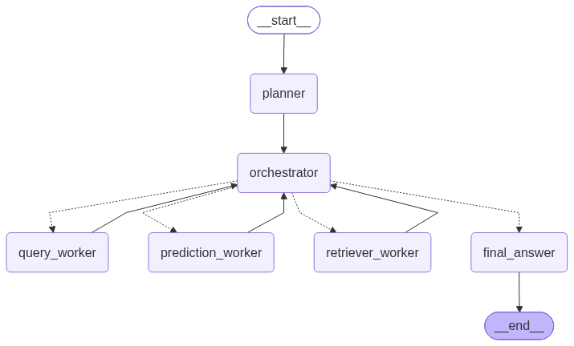
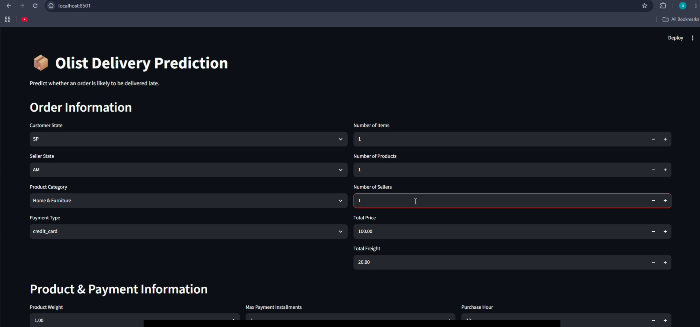
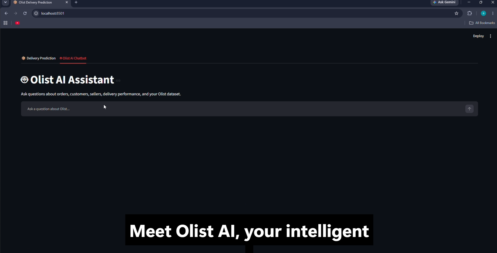
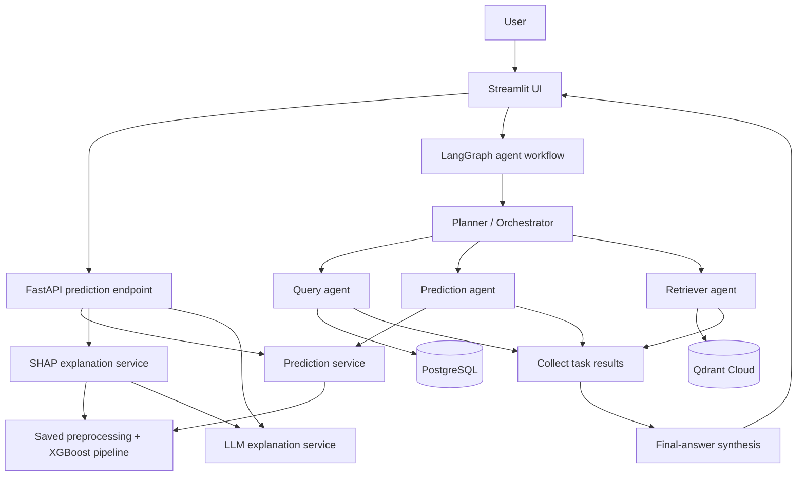
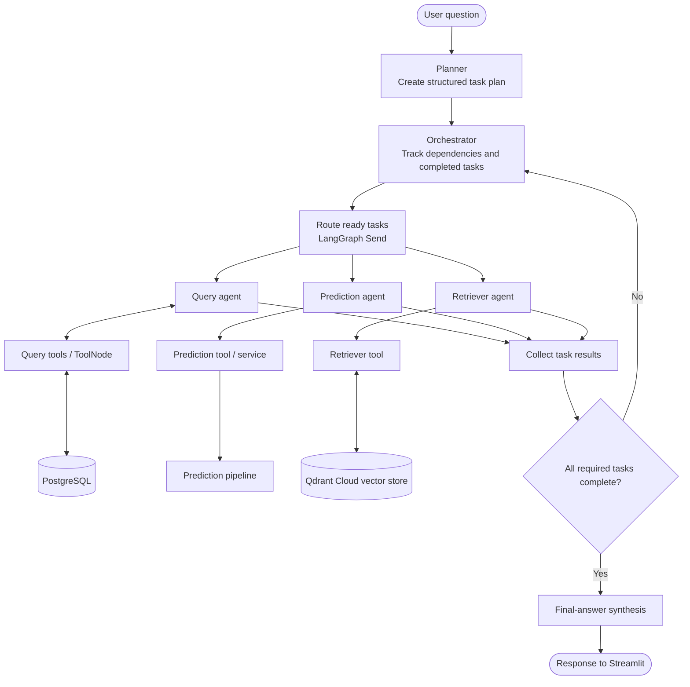

# Olist Logistics Intelligence

**An end-to-end machine-learning and agentic-AI application for delivery-delay risk prediction, model explainability, and natural-language data exploration.**

[GitHub repository](https://github.com/Armanix-01/Olist-Logistics-Intelligence) · [Demo video and supporting material](https://drive.google.com/drive/folders/1ARy35ikhISf5VZfVRopAB3RFkSTskgWC?usp=sharing)

> **Project status:** The application has been tested locally. Dockerfiles and a Docker Compose configuration are included for local container builds and execution. A public/remote deployment is not currently claimed.

## Overview

Olist Logistics Intelligence uses e-commerce order and shipping features to estimate the risk of late delivery. It combines a trained XGBoost classification pipeline with a FastAPI prediction service, a Streamlit interface, SHAP feature attributions, and an LLM-generated explanation.

A separate LangGraph-based agent workflow supports task planning and delegation to query, prediction, and retrieval agents. PostgreSQL is used for structured data and Qdrant Cloud for vector retrieval.

The project demonstrates an applied AI workflow covering data preparation, model training and evaluation, API serving, explainability, retrieval, agent orchestration, and containerization.

## Features

- **Delivery-delay prediction:** returns a predicted class and estimated probability of late delivery.
- **SHAP explainability:** returns influential transformed-feature contributions and indicates whether they push the model's late-delivery probability up or down.
- **LLM-generated explanation:** explains the model output using the prediction and SHAP results supplied to it.
- **Streamlit interface:** provides a delivery prediction screen and a separate AI-chat interface.
- **Agentic workflow:** includes planning/orchestration, query, prediction, and retrieval workers, task-result collection, final-answer synthesis, and progress updates where implemented.
- **Data infrastructure:** PostgreSQL for relational queries and Qdrant Cloud for vector retrieval.
- **Containerization:** separate API and Streamlit Dockerfiles plus Docker Compose for local execution.

## Demo

- **Video and supporting material:** [Google Drive folder](https://drive.google.com/drive/folders/1ARy35ikhISf5VZfVRopAB3RFkSTskgWC?usp=sharing)
- **Source code:** [GitHub repository](https://github.com/Armanix-01/Olist-Logistics-Intelligence)

### Screenshots

Add sanitized screenshots to `docs/images/` and update/uncomment the corresponding image references below. Do not include API keys, database credentials, private user data, or secret-bearing logs in screenshots.

<!--




-->

## System architecture

This diagram is a high-level overview. The actual service names, ports, volumes, and environment variables are defined in the source code and `docker-compose.yml`.



## Agent workflow and structure

The following diagram shows the main workflow conceptually. It is intended to make the orchestration easy to understand; inspect the `agent/` source for the exact graph edges, state schema, task dependencies, and tool names.



**Space for the actual agent graph image:** export a screenshot from your LangGraph graph visualization or create a clean workflow image, save it as `docs/images/agent-workflow.png`, then uncomment the line below. Ensure the image reflects the current graph rather than an earlier version.

<!--  -->

### Agent responsibilities

| Component | Responsibility |
|---|---|
| Planner | Converts the user's request into a structured plan with tasks and dependencies. |
| Orchestrator | Determines which tasks are ready to run and tracks completed results. |
| Query agent | Handles supported structured-data questions using query tools and PostgreSQL. |
| Prediction agent | Invokes the delivery-risk prediction capability when a plan needs a model prediction. |
| Retriever agent | Retrieves relevant context from the configured vector store. |
| Result collection / finalization | Collects worker outputs and prepares the information for the final response. |
| Final-answer synthesis | Produces a user-facing answer grounded in the available worker results. |

The query, prediction, and retrieval workers may be dispatched in parallel when task dependencies allow it. The direct prediction-explanation endpoint (model + SHAP + LLM) is a separate path from the agent workflow unless the application code explicitly routes a request through both.

## Model evaluation

Reported held-out evaluation metrics from the current evaluation run:

| Metric | Score |
|---|---:|
| Accuracy | 0.8072 |
| Precision | 0.2298 |
| Recall | 0.5853 |
| F1-score | 0.3300 |
| F2-score | 0.4470 |
| ROC-AUC | 0.7856 |

**Interpretation:** recall is higher than precision. The model detects a portion of the late-delivery cases, but many cases flagged as late are false positives. Accuracy alone is not sufficient to assess performance on an imbalanced dataset. F2 weights recall more heavily than precision, which may be appropriate when missing a late order is more costly than flagging an order that ultimately arrives on time.

These scores describe the recorded evaluation run and do not guarantee future performance. When available, also document the class distribution, train/test split, decision threshold, and training date. Treat the predictions as risk estimates rather than confirmed delivery outcomes.

## Technology stack

| Area | Tools |
|---|---|
| Data processing | Python, pandas, NumPy |
| ML and tuning | scikit-learn, XGBoost, RandomizedSearchCV |
| Explainability | SHAP |
| API | FastAPI, Pydantic, Uvicorn |
| UI | Streamlit |
| Agent orchestration | LangGraph, LangChain |
| LLM | OpenAI API through the configured LangChain integration |
| Data stores | PostgreSQL, Qdrant Cloud |
| Packaging | Docker, Docker Compose |

## Repository structure

The top-level structure below is based on the repository view. The comments summarize each directory's purpose rather than listing every file inside it. `README.md` is the conventional filename; consider renaming the existing `readme.md` to `README.md`.

```text
Olist-Logistics-Intelligence/
├── .vscode/                    # Editor settings
├── agent/                      # LangGraph workflow, nodes/workers, prompts and state
├── api/                        # FastAPI routes, schemas, prediction/explanation services
├── artifacts/                  # Saved model and related artifacts (as committed)
├── configs/                    # Project and pipeline configuration
├── data/                       # Raw/cleaned/processed data where available
├── database/                   # SQL schemas and database utilities
├── docs/                       # Architecture, API, setup and ML documentation
│   └── images/                 # Add README screenshots and agent workflow image here
├── rag/                        # Retrieval and vector-store components
├── scripts/                    # Utility scripts
├── src/                        # ETL, feature engineering, preprocessing and training
├── streamlit_app/              # Streamlit frontend
├── .dockerignore
├── .env.example                # Add this sanitized template at the repository root
├── .gitignore
├── Dockerfile.api
├── Dockerfile.streamlit
├── docker-compose.yml
├── requirements-api.txt
├── requirements-lock.txt
├── requirements-streamlit.txt
├── requirements.txt
└── README.md
```

**Important:** this is a public-facing overview, not a guaranteed exhaustive tree. Keep it synchronized with the files actually committed. The screenshot currently shows `readme.md` and does not show `.env.example`; rename/add those files in the repository if you adopt the names shown above. Do not commit real `.env` secrets or private datasets/model artifacts unintentionally.

## Quick start with Docker Compose

**Prerequisites:** Git and Docker Desktop/Engine with Docker Compose.

```bash
git clone https://github.com/Armanix-01/Olist-Logistics-Intelligence.git
cd Olist-Logistics-Intelligence
```

1. Review `docker-compose.yml`, `Dockerfile.api`, `Dockerfile.streamlit`, and `.dockerignore`.
2. Review `.env.example`, compare every variable against the actual configuration code, and copy it to `.env`.
3. Replace placeholders with your own credentials. Verify that the required model artifact and background data are available where the containers expect them.
4. Validate and start the application:

```powershell
# Windows PowerShell
Copy-Item .env.example .env
```

```bash
# macOS / Linux
cp .env.example .env
```

Then validate and start the services:

```bash
docker compose config
docker compose up --build
```

Run in the background:

```bash
docker compose up --build -d
```

Inspect services and logs:

```bash
docker compose ps
docker compose logs -f
```

To view a single service's logs, replace `<service-name>` with the exact key under `services:` in `docker-compose.yml`:

```bash
docker compose logs -f <service-name>
```

Stop containers:

```bash
docker compose down
```

`docker compose down --volumes` also removes Compose-managed volumes and may delete persisted local data. Use it only when you intentionally want to reset that data. Docker images stay in the local Docker image store unless explicitly pushed to a registry.

> The commands above are a usage guide, not a claim that a fresh-clone run has been verified on every machine. Exact environment variables, initialization steps, and required artifacts must match the committed configuration.

## Run locally with Python

Python 3.12 was used during development; verify the pinned dependencies on your system.

**Windows PowerShell**

```powershell
py -3.12 -m venv .venv
.\.venv\Scripts\Activate.ps1
```

**macOS/Linux**

```bash
python3.12 -m venv .venv
source .venv/bin/activate
```

Install the requirements appropriate to the services you want to run. Review package overlap before installing multiple requirements files:

```bash
pip install -r requirements-api.txt
pip install -r requirements-streamlit.txt
```

Make sure the API dependencies include SHAP if the prediction endpoint computes SHAP explanations. Configure credentials, model path, processed background-data path, and any PostgreSQL/Qdrant settings required by the relevant workflow.

Start the API from the repository root:

```bash
uvicorn api.main:app --reload
```

In another terminal, start the entry point that exists in your checkout. For example, if the app file is `streamlit_app/app.py`:

```bash
streamlit run streamlit_app/app.py
```

Open the FastAPI interactive documentation at [http://127.0.0.1:8000/docs](http://127.0.0.1:8000/docs) while the API is running. When the UI and API run in separate containers, configure the UI with the API's Compose service hostname instead of `127.0.0.1`.

## API overview

The main prediction endpoint is `POST /predict`. The response is designed to include:

- `is_late`: predicted class (`1` = late, `0` = not late)
- `late_probability`: estimated probability of late delivery
- `shap_baseline_probability`: SHAP reference probability
- `explanation`: top SHAP feature contributions
- `llm_explanation`: natural-language explanation based on the prediction and SHAP output

See [API documentation](docs/API.md) for the example request and response. The Pydantic schema in `api/schemas.py` is authoritative if it differs from this summary.

## Security and limitations

- Never commit `.env`, API keys, passwords, connection strings, secret-bearing logs, or private data.
- Commit `.env.example` with placeholders only. Check `.gitignore` to ensure `.env` is ignored.
- SHAP values describe model attribution; they do not prove causation.
- LLM explanations can be imperfect and should be grounded in actual model output and SHAP values.
- Precision is relatively low at the reported threshold, so a positive prediction is a risk flag, not a confirmed delay.
- Historical data may not represent future marketplace conditions.
- This repository does not claim a completed public deployment, production monitoring, authentication, or rate limiting.

## Further documentation

- [System architecture](docs/ARCHITECTURE.md)
- [Setup and Docker guide](docs/SETUP.md)
- [API reference](docs/API.md)
- [ML methodology and evaluation](docs/ML_DOCUMENTATION.md)

## Author

**Armanix** · [GitHub](https://github.com/Armanix-01)
